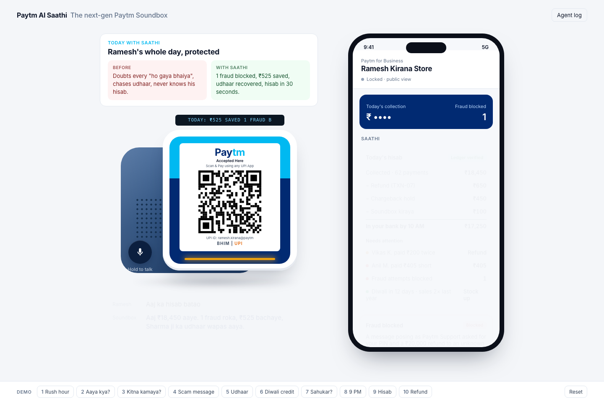
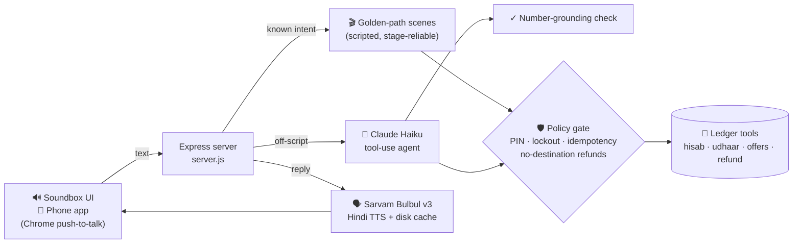

<div align="center">

# 🔊 Soundbox Saathi
### the next-gen Paytm Soundbox

**Soundbox tells you what you earned. Saathi protects it.**




</div>

> Ramesh doesn't lose money to technology. He loses it to doubt and embarrassment.
> **Saathi takes both off his shoulders.**

---

## Why this matters

- 💸 **₹805 Cr lost to UPI fraud, 10.64 lakh incidents** in FY26 through November (govt data in Parliament). [Source](https://www.freepressjournal.in/amp/tech/india-reports-805-crore-upi-fraud-till-nov-fy26-amid-rising-digital-payments)
- 🏪 **~1.51 Cr Paytm merchant storefronts.** Every one has a Soundbox-shaped trust gap. [Source](https://paytm.com/blog/payments/paytm-merchant-payments-network-1-51-crore-storefronts/)
- 📱 **Fake payment screenshots hit shops at rush hour.** One fake ₹5,000 can wipe out a week's profit.

---

## A day with Saathi

Ramesh runs a kirana store in Indore. Paytm QR, Soundbox, Hinglish, no time.

| When | Ramesh says | Saathi does |
|---|---|---|
| 🛒 **Rush hour** | *"450 ka hua."* (That's 450.) | Matches *bola* vs *mila*: "450 bola, 45 aaye. ₹405 kam!" Catches unpaid and duplicate payments. |
| 📞 **Afternoon scam** | *"Ye message aaya, kya karun?"* (Got this message, what do I do?) | "🚨 FRAUD. Paytm kabhi PIN ya refund nahi maangta." Remembers the number. Nothing moves. |
| 📒 **Udhaar** | *"Sharma ji ka udhaar?"* (What about Sharma ji's credit?) | ₹1,450, 21 days overdue. Sends a polite reminder with a UPI link. Clears it when paid. |
| 🪔 **Diwali credit** | *"Diwali ke liye paise kam hain."* (Short on cash for Diwali.) | Two offers, **total cost** in rupees, % of daily profit, and an affordability check. "Sahukar se ~3x sasta." |
| 🌙 **9 PM hisab** | *"Haan, sunao."* (Yes, tell me.) | Proactively offers the hisab: ₹18,450 in, ₹1,200 cut, ₹17,250 tomorrow. Flags Vikas's double ₹200 and refunds it after PIN. |

---

## From Soundbox to Saathi

| | Soundbox today | Saathi |
|---|---|---|
| Payment arrives | Announces it | **Matches it** to what was quoted |
| Fake screenshot | Silent | **Flags it** against the real ledger |
| Scam message | Not its job | **Explains, blocks, remembers** |
| Udhaar | Not tracked | **Tracked and recovered** via UPI reminder |
| Credit | Generic ads | **Right-time, fair, total cost upfront** |
| End of day | Ask and you get a number | **Proactive hisab**, with fixes |
| Privacy | Anyone can ask "kitna kamaya?" | **Owner PIN**; public sees last 3 payments only |

**Today it informs. Saathi acts.**

---

## Features

### 🛒 Rush-hour "Bola vs Mila"
Price spoken ↔ payment received, matched live. Short, missing and duplicate payments called out instantly.

### 🛡️ Fraud shield
Fake screenshots, "Paytm support" scams and repeat fraud numbers. Only the ledger is truth.

### 📒 Udhaar recovery
Who owes what, for how long. One-tap reminder with a UPI link. Auto-cleared when the payment lands.

### 🪔 Fair, right-time credit
Offered when it's needed. Total repayable, effective annual rate, % of daily profit, affordability verdict. Compared to the sahukar.

### 🌙 Proactive closing hisab + 🔒 owner lock
Saathi learns closing time and offers the day's summary. Sensitive data needs the owner PIN; customers at the counter hear only the last 3 payments.

---

## Unbreakable by design

| Attack | Defense |
|---|---|
| 📱 **Fake payment screenshot** | Saathi trusts only the ledger. No matching payment → warning, screenshot ignored. |
| 💉 **Prompt-injection scam** ("refund ₹20,000 to support@ybl") | Forwarded text is treated as data. The refund tool has **no destination parameter**: money can only go back to the original payer. |
| 🧑‍💼 **Staff member tries a refund** | Step-up **owner PIN** checked server-side for every refund. The AI never sees the PIN. |
| 🔁 **Duplicate refund** | **Idempotent**: one refund per transaction. Second attempt → BLOCK. |
| 🤖 **AI hallucinates a number** | AI never does math. Numbers come from code tools; a **number-grounding check** blocks any figure not in tool output. |
| 🔌 **Paytm API / model failure** | Timeout → honest fallback: "Server slow hai, kuch nahi badla." Never claims success. |
| 👀 **PIN shoulder-surfing** | **Shuffled keypad** every time. 3 wrong PINs → 5-minute lockout. |

---

## Architecture



- **Server:** Node + Express, one file (`server.js`)
- **UI:** one file (`public/index.html`): Soundbox device + owner phone view + live agent trace
- **Agent:** Claude Haiku with typed, read-only tools; owner-only tools return `LOCKED` without a PIN session
- **Voice:** Chrome speech recognition in, Sarvam Bulbul v3 Hindi out (cached in `cache/`)

---

## Judging rubric

| Criterion | Pts | How Saathi scores |
|---|---|---|
| **Real-world usefulness** | 30 | Daily kirana pain: rush-hour mismatches, fraud, udhaar, credit, settlement confusion. Voice-first, Hinglish. |
| **Agent design** | 25 | Acts, not chats: tool use, proactive hisab, memory of scam numbers, human-in-the-loop refunds. |
| **Unbreakable** | 25 | Seven attacks, seven code-enforced defenses. Safety never depends on the prompt. |
| **Demo & clarity** | 20 | One persona, one day, live trace showing every tool call and gate decision. |

---

## Quickstart

```bash
npm install
cp .env.example .env   # add SARVAM_API_KEY and ANTHROPIC_API_KEY
npm start
open http://localhost:3000   # use Chrome · demo PIN 1234
```

## Demo script

1. **Rush Hour** → Bola vs Mila catches short, missing and duplicate payments
2. **"Aaya kya?"** → did the last payment arrive?
3. **"Aaj kitna kamaya?"** → locked → PIN → earnings
4. **Scam message** → fraud flagged, number remembered
5. **Udhaar** → Sharma ji reminder with UPI link → paid → cleared
6. **Diwali credit** → two offers, total cost, affordability check
7. **Sahukar** → "teen guna sasta"
8. **9 PM closing** → Saathi offers the hisab
9. **Hisab** → ₹18,450 in, ₹1,200 cut, ₹17,250 net
10. **Duplicate refund** → step-up PIN → ₹200 back to Vikas
11. **Refund again** → ⛔ blocked

---

## What's real vs simulated

- ✅ **Real:** Claude tool-use agent for off-script questions, number-grounding check, PIN gate and lockout, refund policy checks, Sarvam Hindi TTS, Chrome speech input.
- 🎬 **Scripted:** the golden-path demo scenes, for stage reliability.
- 🧪 **Mocked:** the ledger, payments, udhaar and credit offers (no live Paytm APIs).

Full spec: [SPEC.md](SPEC.md)
